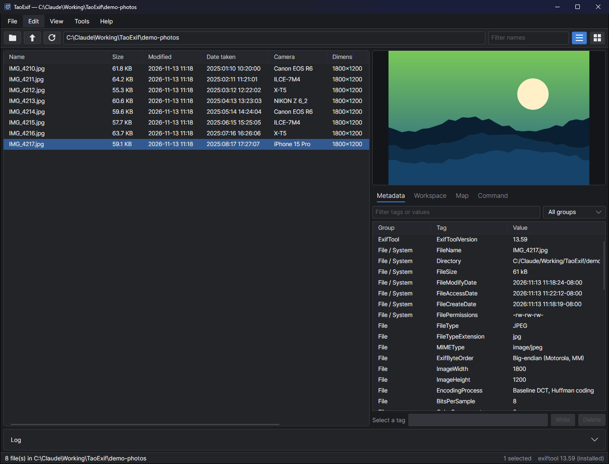
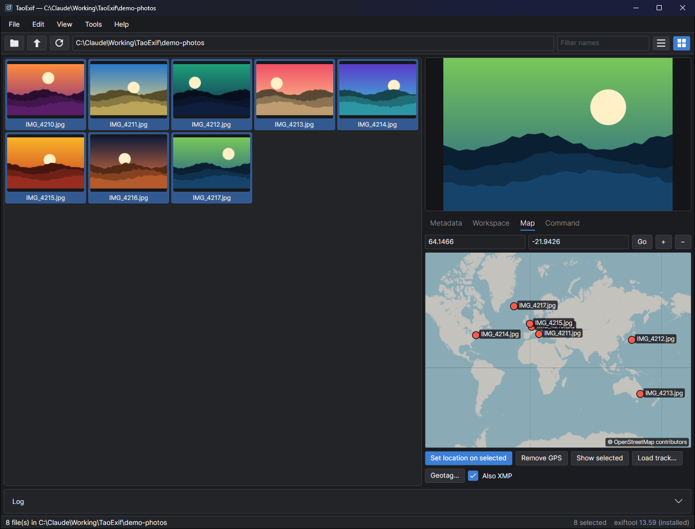
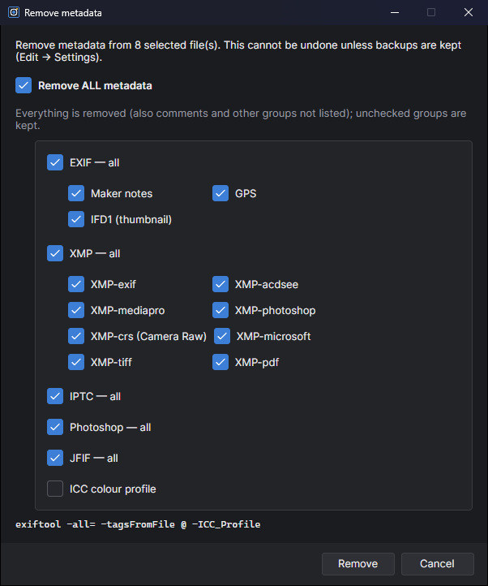

# TaoExif

A cross-platform, dark-mode GUI for Phil Harvey's [ExifTool](https://exiftool.org/), inspired by
[ExifToolGui](https://github.com/FrankBijnen/ExifToolGui) (Bogdan Hrastnik, Frank Bijnen). It's a new
implementation in C# / .NET 10 with [Avalonia 12](https://avaloniaui.net/), and it runs on Windows, Linux and macOS.



## Download

Get the latest build from [Releases](https://github.com/Taoism/TaoExif/releases). Unpack it anywhere and run
`TaoExif` (`TaoExif.exe` on Windows). ExifTool is included, so you don't need to install anything else.

- **Windows x64**: `TaoExif-<version>-win-x64.zip`
- **Linux x64**: `TaoExif-<version>-linux-x64.tar.gz` (needs `perl` for the bundled ExifTool; see below)
- **macOS Apple silicon**: `TaoExif-<version>-osx-arm64.tar.gz`. The build is not signed, so the first time,
  open it with right-click → Open, or run `xattr -dr com.apple.quarantine TaoExif`.

## Features

- **Browse**: folder tree, path box, recent folders, optional subfolders, name filter. Details view with
  configurable tag columns, or a thumbnail view (EXIF orientation applied; RAW/HEIC use the embedded preview).
- **Preview** of the selected file (JPEG/PNG/WebP decoded directly, RAW/HEIC/TIFF via exiftool's embedded JPEGs).
- **Metadata tab**: every tag grouped by family 0/1 (EXIF / IFD0, XMP / XMP-dc, MakerNotes …), with filter and
  group selector. You can edit or delete a single tag across all selected files. Right-click a tag to copy it, or
  add it as a file list column or a workspace field.
- **Workspace tab**: your own list of frequently edited fields (title, keywords, copyright, city, …). When several
  files are selected it shows whether their values differ, and it writes only the fields you changed (Ctrl+S).
- **Map tab**: built-in OpenStreetMap map, drawn natively (no browser engine). It shows GPS markers for the folder,
  sets a location by clicking the map or typing coordinates, removes GPS, and draws GPX tracks.
- **Command tab**: run any exiftool command on the selection, the folder or no files, with saved presets.
- **Tools**: shift date/time (EXIF, XMP, QuickTime, file date), rename from a date tag or a name template with a
  dry-run preview, copy metadata from a file (all or chosen groups), remove metadata (all, keeping ICC, or by
  group), geotag from a GPX/KML/NMEA log with a time correction, delete `*_original` backups, export the
  selection as CSV/JSON.
- **Right-click menu** on files, thumbnails and the preview: remove metadata, remove GPS, copy metadata, shift
  dates, rename, geotag, export, open, show in folder.
- **Remove metadata** with ExifToolGui-style choices: remove everything (keeping only what you untick), or just
  chosen groups (EXIF, maker notes, GPS, IFD1, XMP and its sub-groups, IPTC, Photoshop, JFIF, ICC profile).
- Dark everywhere, including the message boxes and dialogs.

| Thumbnails and map | Remove metadata |
|---|---|
|  |  |

exiftool runs as a persistent `-stay_open` process, so reads are fast, and file names are passed as UTF-8, so
non-ASCII paths work on Windows.

## ExifTool

TaoExif ships with ExifTool (currently 13.63) in an `exiftool` folder next to the app, so it works without
anything else installed:

- **Windows**: the official Windows package (`exiftool.exe` with its own Perl).
- **Linux / macOS**: the official Perl distribution, run with the system `perl`. macOS and most Linux desktops
  include Perl. On minimal installs without it, install Perl or exiftool itself
  (`sudo dnf install perl-Image-ExifTool`, `sudo apt install libimage-exiftool-perl`, `brew install exiftool`).

The order it uses: the path set in **Edit → Settings**, then an exiftool installed on the system (PATH, Program
Files, Homebrew, /usr/bin …), then the bundled copy. The status bar shows which one is in use, e.g.
"exiftool 13.63 (bundled)".

The bundle is downloaded by `tools/fetch-exiftool.ps1`, which checks each file against exiftool.org's SHA-256 list.
The build runs it automatically when `third_party/exiftool` is missing. To update to a newer ExifTool, run
`tools/fetch-exiftool.ps1 -Force`. To build without a bundle, pass `-p:TaoExifBundleExifTool=false`.

## Build

```
dotnet build TaoExif.sln
dotnet test tests/TaoExif.Tests          # uses an installed exiftool, else the bundled one
dotnet publish src/TaoExif -c Release -r win-x64   --self-contained -p:PublishSingleFile=true -p:IncludeNativeLibrariesForSelfExtract=true -o publish/win-x64
dotnet publish src/TaoExif -c Release -r linux-x64 --self-contained -p:PublishSingleFile=true -p:IncludeNativeLibrariesForSelfExtract=true -o publish/linux-x64
dotnet publish src/TaoExif -c Release -r osx-arm64 --self-contained -p:PublishSingleFile=true -p:IncludeNativeLibrariesForSelfExtract=true -o publish/osx-arm64
```

## Layout

- `src/TaoExif.Core`: the exiftool process wrapper (`ExifToolProcess`), the high-level operations
  (`ExifToolService`), settings, and the GPX reader. It has no UI dependencies.
- `src/TaoExif`: the Avalonia app (main window split into `MainWindow.*.cs`, dialogs, map control, theme).
- `tests/TaoExif.Tests`: xUnit tests that run against the real exiftool.

Settings are stored in `%APPDATA%\TaoExif\settings.json` (Windows) or `~/.config/TaoExif/settings.json`
(Linux/macOS). Map tiles are cached under `tiles/` next to the settings file.

Map data © OpenStreetMap contributors.

## License

MIT, see [LICENSE](LICENSE). ExifTool is © Phil Harvey and is distributed under the same terms as Perl; see
[THIRD-PARTY-NOTICES.txt](THIRD-PARTY-NOTICES.txt).
